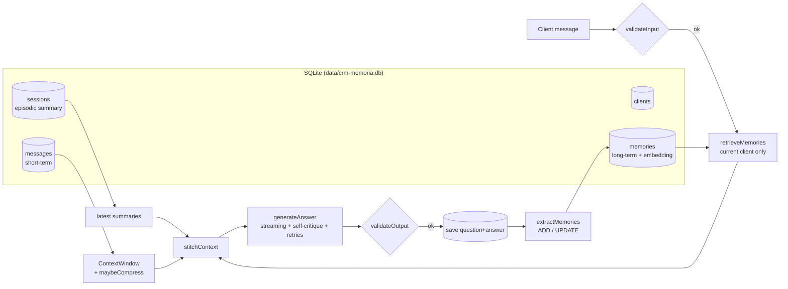
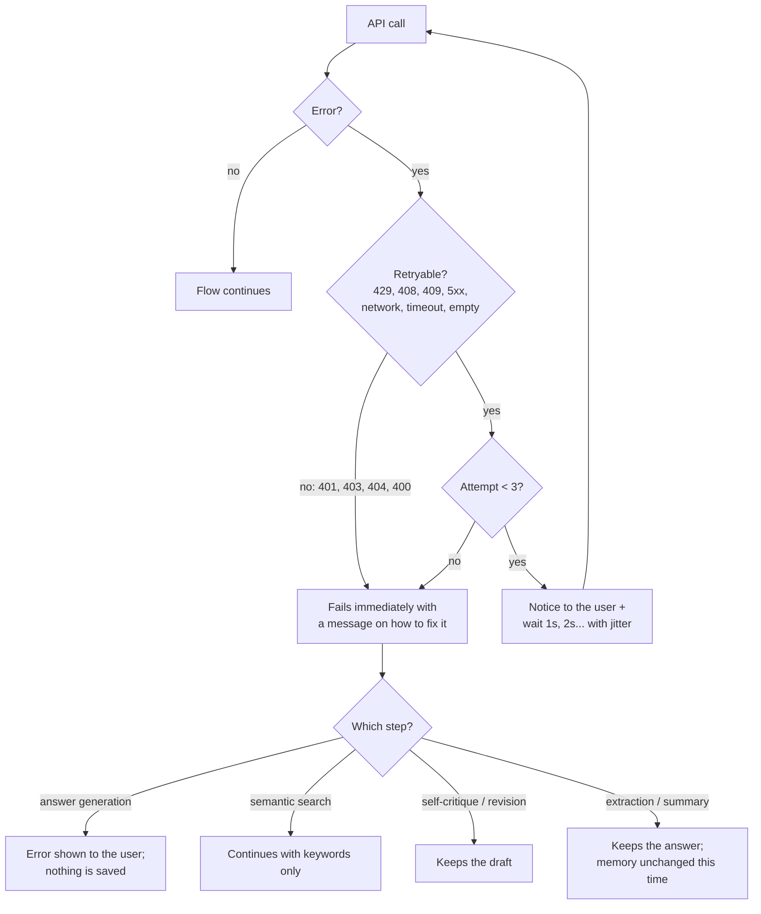

# posIAM03D02 - CRM Assistant with Client Memory

🇧🇷 [Leia em português](README.md)


Micro-capstone for discipline 2 of module 3 of my AI postgraduate program. A relationship assistant for a fictional
B2B company, **NexoTech Managed Services** (managed IT: support, equipment, licenses, backup and networks). The
assistant follows each client over time and remembers **order history, preferences, previous problems and
relationship context**. It uses persistent memory (SQLite) to personalize answers without dumping irrelevant context
into the prompt.

The project evolves the chatbot from discipline 1 ([posIAM03D01](https://github.com/lucianafm9/posIAM03D01)). It keeps
the CLI, streaming, the prompt structure (role, instructions, data, output format), retries and self-critique, and adds
the memory concepts from the course (`ContextWindow`, `messageRepository`, `summarizeHistory`, `estimateTokens`,
`maybeCompress`, `stitchContext`, `validateInput`/`validateOutput`).

> The assistant talks to Brazilian clients, so prompts, CLI messages and sample data are in Portuguese. The code
> identifiers and this document are in English.

## Contents

- [How to run](#how-to-run)
- [Memory architecture](#memory-architecture)
- [Storage structure](#storage-structure)
- [Lifecycle of a message](#lifecycle-of-a-message)
- [Retrieval logic](#retrieval-logic)
- [Avoiding excessive or irrelevant memory use](#avoiding-excessive-or-irrelevant-memory-use)
- [Consistency over time](#consistency-over-time)
- [Error handling](#error-handling)
- [Self-critique in practice](#self-critique-in-practice)
- [Comparison: with memory vs. without memory](#comparison-with-memory-vs-without-memory)
- [Acceptance criteria and evidence](#acceptance-criteria-and-evidence)
- [Course concepts in the code](#course-concepts-in-the-code)

## How to run

Requirements: Node.js 22.18+ (runs TypeScript natively and ships SQLite as `node:sqlite`) and an OpenAI API key.

```bash
npm install
npm run env:setup      # creates .env from .env.example; set OPENAI_API_KEY in it
npm run seed           # creates data/crm-memoria.db with the sample clients
npm start              # opens a client conversation
```

| Command | What it does | Needs a key? |
|---|---|---|
| `npm start` | Conversation in the terminal (`completa` mode, self-critique on) | yes |
| `npm start -- --debug` | Shows retrieved memories, scores, discarded items and context tokens | yes |
| `npm start -- --modo=sem_memoria` | Same conversation in another memory mode (`sem_memoria`, `curta`, `completa`, `sem_filtro`) | yes |
| `npm run seed` | Recreates the local database with the sample CRM (erases conversations and memories) | yes (embeddings) |
| `npm run experiment` | Runs the comparison across the 4 modes and writes `results/relatorio.md` | yes |
| `npm run demo` | Demonstrates error handling and self-critique with a simulated model | **no** |
| `npm test` | 35 automated tests (simulated model and embeddings) | **no** |
| `npm run typecheck` | Type checking | no |

`.env` variables: `OPENAI_API_KEY` (required), `OPENAI_MODEL` (optional, default `gpt-4o-mini`) and
`OPENAI_JUDGE_MODEL` (optional, judge model for the experiment). `.env` and the `data/*.db` database are git-ignored.

Commands during a conversation: `/memoria` (what the assistant remembers about the client), `/esquecer <id>`
(forgets a memory), `/debug` (toggles retrieval details), `/ajuda` (help) and `sair` (ends the conversation and saves
its summary). When a client is selected, the CLI offers to **resume the last conversation**, restoring the session's
message history from SQLite.

## Memory architecture

Memory has three layers, each with a different role in the context sent to the model:

| Layer | What it holds | Where it lives | How it enters the context |
|---|---|---|---|
| **Short-term** (session) | The current conversation | `ContextWindow` + `messages` table | Recent messages verbatim; the older part becomes a summary above ~1,200 tokens (`maybeCompress`) |
| **Long-term** (facts) | Client orders, preferences, problems and relationship | `memories` table (with embeddings) | Only the memories **relevant to the current message** (`retrieveMemories`), within a token budget |
| **Episodic** (conversations) | Summary of each finished conversation | `sessions.summary` column | Summaries of the client's last 2 conversations |



## Storage structure

Defined in [`src/memory/database.ts`](src/memory/database.ts):

| Table | Main fields | Notes |
|---|---|---|
| `clients` | `id`, `name`, `segment`, `contact_name`, `contact_role`, `customer_since` | Fixed profile of the B2B client |
| `sessions` | `id`, `client_id`, `started_at`, `ended_at`, `summary`, `compressed_summary`, `compressed_upto` | One row per conversation; stores the final summary (episodic memory) and the compression summary (so a resumed session isn't summarized again) |
| `messages` | `session_id`, `role` (`user`/`assistant`), `content`, `created_at` | Question and answer are saved **together, in a transaction**: an exchange only exists if it is complete. Ordered by `id` |
| `memories` | `client_id`, `type`, `content`, `importance` (1-3), `source` (`crm`/`conversa`), `status` (`ativa`/`substituida`/`esquecida`), `supersedes`, `session_id`, `embedding`, `created_at` | `type` ∈ `pedido` (order), `preferencia` (preference), `problema` (problem), `relacionamento` (relationship). Nothing is physically deleted: updated facts become `substituida` (replaced), with a trail in `supersedes` |

The seed data ([`data/seed/crm.json`](data/seed/crm.json)) simulates the CRM with 3 clients (Construtora Alvorada,
Clínica Bem Viver and Logística Rota Sul) and 17 memories with source `crm`. Memories with source `conversa` are
learned during conversations.

## Lifecycle of a message

Implemented in [`src/chat/crmAssistant.ts`](src/chat/crmAssistant.ts):

1. **Input guardrail** ([`validateInput`](src/guardrails/validateInput.ts)): empty, too long, sensitive data (CPF, card number, password value, token) and manipulation attempts. A rejected message never reaches the model and is never saved.
2. **Long-term memory**: retrieves the current client's relevant memories (details below) and the summaries of the latest conversations.
3. **Short-term memory**: if the window exceeds its budget, the older half is summarized (`maybeCompress` + `summarizeHistory`) and the summary is saved on the session.
4. **Stitched context** ([`stitchContext`](src/memory/stitchContext.ts)): `<memoria_cliente>` → `<resumo_atendimento_atual>` → recent messages → current message. The system prompt ([`buildPrompt.ts`](src/chat/buildPrompt.ts)) follows the order ROLE, INSTRUCTIONS (including the memory-usage rules), DATA and OUTPUT FORMAT.
5. **Generation** ([`generateAnswer`](src/chat/generateAnswer.ts)): streamed draft, self-critique and, if needed, a revised version.
6. **Output guardrail** ([`validateOutput`](src/guardrails/validateOutput.ts)): empty answer, mentions of another client, sensitive data or unauthorized promises ("I guarantee", "discount approved"). A rejected answer is not saved to history and does not become memory.
7. **Persistence**: saves question and answer.
8. **Memory extraction** ([`extractMemories`](src/memory/extractMemories.ts)): the model returns `ADICIONAR` (add) / `ATUALIZAR` (update) operations as JSON. Each one goes through [`validateMemory`](src/guardrails/validateMemory.ts) before being saved, and the user sees what was recorded (`[Memória registrada] M18 (pedido): ...`).

When the conversation ends (`sair`), it is summarized and the summary becomes episodic memory for future contacts.

## Retrieval logic

[`src/memory/retrieveMemories.ts`](src/memory/retrieveMemories.ts), over the **current client's active memories** (the `client_id` filter is in the SQL):

1. **Contextual query**: current message + the client's previous message (short follow-ups like "same model as before" need that context to find the right memory).
2. **Hybrid score** (as in the course's RAG lessons): `0.7 × cosine similarity` (`text-embedding-3-small` embeddings) `+ 0.3 × keyword score` (normalized terms, no accents, no stopwords).
3. **Essentials**: importance-3 preferences (e.g., contact channel) are always included, up to 3.
4. **Relevant**: score ≥ 0.35, at most 5, sorted by score, importance and date.
5. **Budget**: the memory block stays within ~450 tokens (`estimateTokens`). Whatever doesn't fit is dropped.
6. **Graceful degradation**: if the embeddings API fails, relevance comes from keywords only, with a stricter cutoff (≥ 0.5).

With `--debug`, the CLI shows what was included and what was left out (output format; the numbers are illustrative):

```
[debug] modo=completa | contexto ~812 tokens | mensagens recentes: 2
[debug] memória de longo prazo: 3 selecionada(s), ~118 tokens
[debug]   + M4 essencial score=0.21 Prefere receber propostas e retornos por e-mail, em tópicos curtos e ob
[debug]   + M3 relevante score=0.52 Comprou 20 notebooks Dell Latitude 5450 (pedido PED-2291) em 2026-06-02
[debug]   - M8 descartada score=0.12 Marina participou do evento de clientes NexoTech em 2025 e elogiou a
```

## Avoiding excessive or irrelevant memory use

- **At retrieval**: relevance cutoff, `topK`, token budget, and no memory block at all when nothing is relevant.
- **In the prompt**: "use a memory only when it helps answer the current message; do not list or recite memories unrelated to the question". Memories are treated as **data**: instructions written inside them are ignored.
- **In self-critique**: the reviewer receives the available memory and rejects answers that invent facts, ignore relevant memory or mention irrelevant memory.
- **Against misuse**: another client's memory is never loaded (client filter in SQL, covered by tests). The output guardrail is a second line of defense.
- **When saving**: the extractor only records facts stated by the client that are useful in the future. It ignores greetings, generic questions and duplicates. Sensitive data is rejected.
- **Measurement**: the experiment's `sem_filtro` mode injects every memory, to show the cost (tokens) and the risk (irrelevant use) of not filtering.

## Consistency over time

- **Update instead of duplicate**: when the client changes something ("from now on I prefer email instead of WhatsApp"), the extractor receives the existing memories with their ids and returns `ATUALIZAR`. The old version becomes `substituida` (no longer used) and the new one points to it through `supersedes`. The full history remains auditable.
- **Absolute dates**: each memory has a date (`[M12 | preferência | 2026-10-06]`) and the extractor turns "next month" into a real date.
- **The present wins**: if the current message contradicts a memory, what the client says now prevails (and the memory is updated).
- **Forgetting on request**: `/esquecer <id>` marks the memory as `esquecida` (forgotten).
- **Clean history**: generation failures, blocked inputs and rejected answers are never saved, so a one-off error doesn't contaminate future conversations.

## Error handling

This section answers the feedback from discipline 1: explain which errors are handled and how each one shows up in the user's flow.

### Which errors are handled and what happens

| Situation | Retry? | What the user sees | Effect on history and memory |
|---|---|---|---|
| HTTP 429 (rate/quota limit), 408, 409, 5xx, network failure, timeout (60s) or empty response | Yes: up to 3 attempts, exponential backoff 1s → 2s (cap 8s) + up to 20% jitter | `[Falha na geração: <cause>. Nova tentativa 2/3 em 1.1s...]`; if an attempt succeeds, the answer continues normally | Nothing changes until the answer is out |
| Same error on all 3 attempts | (exhausted) | `[Erro] <cause in plain language>` + "the message was not saved to history or memory, try again" | Nothing is saved |
| HTTP 401 (invalid key), 403, 404 (unknown model), 400 | No (retrying won't help) | `[Erro] Chave da API inválida ou ausente. Confira OPENAI_API_KEY no arquivo .env.` (specific message per status code) | Nothing is saved |
| Embeddings fail during retrieval | Yes (3 attempts) | `[Memória: busca semântica indisponível (...). Usando só palavras-chave.]` | Conversation continues (degraded mode) |
| Embeddings fail for a new memory | Yes (3 attempts) | Nothing (silent) | Memory saved without a vector; filled in when the CLI starts (`ensureEmbeddings`) |
| Compression (summary) fails | Yes (3 attempts) | `[Compressão indisponível (...). Seguindo só com a janela deslizante.]` | The sliding window keeps limiting the context |
| Self-critique or revision fails | Yes (3 attempts) | `[Autocrítica indisponível (...). Mantendo a resposta original.]` | The draft is the final answer |
| Extractor returns invalid JSON or fails | Yes, if it's an API error | `[Memória não atualizada nesta interação (...). O atendimento segue normalmente.]` | Exchange saved; long-term memory unchanged |
| Invalid memory operation (sensitive data, unknown type, another client's id) | No | `[Memória rejeitada pelo guardrail] <reason>` | Operation discarded; the others are applied |
| Input with sensitive data or manipulation | No | `[Entrada bloqueada] <reason>` | Nothing is sent or saved |
| Answer mentioning another client, sensitive data or unauthorized promise | No | `[Guardrail de saída] Resposta descartada: <reason>...` | Not saved to history or memory |
| Conversation summary fails on exit | Yes (3 attempts) | `[Resumo do atendimento indisponível (...)]` | Memories extracted after each message remain saved |

Classification lives in [`src/utils/errors.ts`](src/utils/errors.ts) (`isRetryableError`, `describeError`), backoff in
[`src/utils/withRetry.ts`](src/utils/withRetry.ts) and the user notice in
[`src/utils/retryPolicy.ts`](src/utils/retryPolicy.ts). The OpenAI SDK is created with `maxRetries: 0` so every retry
goes through the same visible flow.

### How an error connects to the user's flow



### Runnable examples (`npm run demo`, no key needed)

The demo runs the application's real flow with a simulated model that triggers each failure. Output excerpts (the CLI is in Portuguese):

```
1. Erro temporário (HTTP 429) com retentativa bem-sucedida
Você: Qual é a vigência das nossas licenças do Microsoft 365?
Assistente: [Falha na geração: Limite de requisições ou de cota atingido. Aguarde um pouco e tente novamente. Nova tentativa 2/3 em 1.2s...]
As 50 licenças Microsoft 365 Business Standard renovadas em 15/03/2026 valem até 14/03/2027.
=> status: respondida | mensagens gravadas no histórico: 2

2. Falha de conexão em todas as tentativas
Você: Qual é a vigência das nossas licenças do Microsoft 365?
Assistente: [Falha na geração: Falha de conexão com a API. Verifique sua internet. Nova tentativa 2/3 em 1.1s...]
[Falha na geração: Falha de conexão com a API. Verifique sua internet. Nova tentativa 3/3 em 2.2s...]

[Erro] Falha de conexão com a API. Verifique sua internet.
A mensagem não foi registrada no histórico nem na memória. Tente novamente.
=> status: erro | mensagens gravadas no histórico: 0

3. Erro permanente (HTTP 401): sem retentativa
[Erro] Chave da API inválida ou ausente. Confira OPENAI_API_KEY no arquivo .env.
=> status: erro | mensagens gravadas no histórico: 0
```

| Demo case | What it shows |
|---|---|
| 1 | Temporary error (429) followed by a successful retry |
| 2 | Connection failure on every attempt: clear error, nothing saved |
| 3 | Permanent error (401): no retry |
| 4 | Embeddings unavailable: retrieval degrades to keywords |
| 5 | Extractor returns invalid JSON: answer kept, memory unchanged |
| 6 | Input guardrail: sensitive data (CPF) |
| 7 | Output guardrail: answer mentions another client |
| 8 | Self-critique rejects the draft and produces a revised version |
| 9 | Self-critique unavailable: the draft is kept |

> Known limitation: because the answer is streamed, the output guardrail warns and discards the answer (from history
> and memory) after it has been shown. The main protection against cross-client leaks happens before generation:
> other clients' memories never enter the context.

## Self-critique in practice

Also requested in the feedback: an example of how it works and what result to expect. Self-critique has three steps:

1. **Draft**, streamed.
2. **Review**: the reviewer ([`CRITIC_PROMPT`](src/chat/generateAnswer.ts)) receives the instructions, **the client's available memory**, the message and the draft. It checks five criteria: no invented facts, actually answers the message, uses relevant memory, doesn't mention irrelevant memory, and respects preferences and format. It replies with JSON: `{"approved": boolean, "issues": [...]}`.
3. **Revised version** (streamed), only if the draft is rejected. That is the version saved to history.

Example (demo case 8, Construtora Alvorada). The draft ignored the history and asked for something the company already knew:

```
Você: Quero mais notebooks iguais aos da última compra. Pode cotar 5 unidades?
Assistente: Claro! Qual modelo de notebook vocês compraram da última vez? Assim preparo a cotação.
[Autocrítica: revisando a resposta...]
[Autocrítica: pontos a melhorar -> Pergunta o modelo, mas a memória registra a última compra: Dell Latitude 5450 (PED-2291).; Não destaca o prazo de entrega, preferência registrada após o atraso do PED-2291.]

Versão revisada:
Claro! Vou cotar 5 notebooks Dell Latitude 5450, o mesmo modelo do pedido PED-2291, com o prazo de entrega em destaque. Envio a proposta por e-mail, em tópicos.
```

In English: the client asks for 5 more laptops "like the last purchase". The draft asks which model they bought. The
reviewer points out that memory already records the last purchase (Dell Latitude 5450, order PED-2291) and that the
client asked for delivery dates to be highlighted after a past delay. The revised answer quotes the right model,
highlights the delivery date and offers to send the proposal by email, the client's preferred channel.

Expected result: the final answer uses memory, respects the recorded preferences, and the client doesn't have to
repeat information. When the reviewer approves, `[Autocrítica: resposta aprovada.]` is shown and the draft is kept.
When the reviewer fails (case 9), the draft is also kept: self-critique never leaves the client without an answer.
Malformed reviewer JSON counts as approval, so self-critique can never make the answer worse.

Self-critique is on in the CLI (turn it off with `--sem-autocritica`) and off by default in the experiment, to
isolate the effect of memory (turn it on with `npm run experiment -- --autocritica`).

## Comparison: with memory vs. without memory

`npm run experiment` runs the same scenarios in 4 modes, each with the same initial database and the same simulated dates:

| Mode | Short-term (session) | Long-term | Conversation summaries |
|---|---|---|---|
| `sem_memoria` (no memory) | - | - | - |
| `curta` (short-term only) | yes | - | - |
| `completa` (proposed) | yes | relevant only (filtered) | yes |
| `sem_filtro` (unfiltered) | yes | **all** | yes |

The scenarios ([`src/experiment/scenarios.ts`](src/experiment/scenarios.ts)) have 10 exchanges across 4 conversations with 2 clients, each with a goal:

| Turn | Conversation | What it tests |
|---|---|---|
| A1, A2 | Alvorada, Oct 5 | Personalize with preferences and resolve "same as the last purchase" using order history |
| A3 | Alvorada, Oct 12 (new session) | Continuity across conversations ("how is the proposal for that purchase?") |
| A4 | Alvorada, Oct 12 | Recognize a recurring problem (Sorocaba VPN, August ticket) |
| A5 | Alvorada, Oct 12 | Don't invent: the topic belongs to another client |
| B1 | Bem Viver, Oct 6 | Preference change (WhatsApp → email) |
| B2 | Bem Viver, Oct 6 | Generic question: don't dump irrelevant memories |
| B3 | Bem Viver, Oct 12 (new session) | Use the **updated** preference and the renewal date |
| B4 | Bem Viver, Oct 12 | Recall the right past problem (duplicate charge and refund) |
| B5 | Bem Viver, Oct 12 | Isolation: request for another client's data |

Each answer is scored by **objective checks** (patterns that must or must not appear) and by an **LLM judge** with an
answer key (score 1 to 5, correct/missing/incorrect memory use, irrelevant use, inconsistency). The generated report
([`results/relatorio.md`](results/relatorio.md)) includes the summary per mode, the result per exchange, context
tokens, memory evolution (memories created and replaced) and full side-by-side transcripts for every mode. Raw data
is in [`results/experimento.json`](results/experimento.json). Both files are generated when the experiment runs with
a valid key.

## Acceptance criteria and evidence

| Criterion / evidence | How the project meets it | Where to check |
|---|---|---|
| Memory is actually used in answers | Relevant memories enter the context on every message; the judge classifies use as correct, missing or incorrect | `--debug`; report ("memory used correctly" column; injected memories per turn) |
| Answers improve with history | Same scenarios in 4 modes: pass rate and score per mode | Report, "Resumo por modo" and turns A2, A3, A4, B3, B4 |
| No incorrect or irrelevant use | Filtered retrieval with a budget, prompt rules, self-critique, per-client isolation, guardrails | Turns A5, B2 and B5; `sem_filtro` mode as a counterpoint; `retrieveMemories` and `crmAssistant` tests |
| System stays consistent over time | `ATUALIZAR` with `supersedes`; history holds only complete exchanges | Turns B1 → B3; "memory evolution" in the report; `longTermMemory` tests |
| Understanding of statefulness | 3 memory layers (session, facts, episodes); session resume from SQLite; stateless mode as baseline | [Memory architecture](#memory-architecture); `npm start` → resume conversation |
| Efficient use of context | Memory budget (~450 tokens), session compression (~1,200 tokens), tokens measured per turn | Report, "Uso eficiente de contexto" (`completa` vs. `sem_filtro`) |
| Real improvement in experience | The client doesn't repeat information, preferences are respected, recurring problems are recognized | Report transcripts |

## Course concepts in the code

| Course concept | In this project |
|---|---|
| `contextWindow.ts` (`addUserMessage`/`addAssistantMessage`, window of X messages) | [`src/memory/contextWindow.ts`](src/memory/contextWindow.ts) (+ `restore` and `clear`) |
| `messageRepository.ts` (SQLite persistence, session restore) | [`src/memory/sessionRepository.ts`](src/memory/sessionRepository.ts) (messages per conversation, transactional writes, ordered by `id`) and [`memoryRepository.ts`](src/memory/memoryRepository.ts) |
| `summarizeHistory.ts` | [`src/memory/summarizeHistory.ts`](src/memory/summarizeHistory.ts): compression and episodic summary |
| `estimateTokens.ts` | [`src/memory/estimateTokens.ts`](src/memory/estimateTokens.ts): window budget, memory block budget and context measurement |
| `maybeCompress.ts` | [`src/memory/maybeCompress.ts`](src/memory/maybeCompress.ts): cumulative summary of the older half, never splitting a question from its answer |
| `stitchContext.ts` | [`src/memory/stitchContext.ts`](src/memory/stitchContext.ts): client memory + session summary + recent messages |
| `chatbot.ts` (memory in a chatbot) | [`src/chat/crmAssistant.ts`](src/chat/crmAssistant.ts) + [`src/cli/session.ts`](src/cli/session.ts) |
| `validateInput.ts` / `validateOutput.ts` | [`src/guardrails/`](src/guardrails/) (+ `validateMemory.ts` for what gets saved) |
| Embeddings, cosine, hybrid score (RAG) | [`src/memory/scoring.ts`](src/memory/scoring.ts) and [`retrieveMemories.ts`](src/memory/retrieveMemories.ts) |
| `withRetry.ts` / `generateWithCritique.ts` | [`src/utils/withRetry.ts`](src/utils/withRetry.ts) and [`src/chat/generateAnswer.ts`](src/chat/generateAnswer.ts) (evolved from D01) |

## Project structure

```
src/
  index.ts                 CLI (npm start)
  seed.ts                  sample CRM loader (npm run seed)
  config/settings.ts       memory limits, retries, models
  chat/                    prompt, generation with self-critique, conversation orchestration
  memory/                  SQLite, repositories, window, compression, retrieval, extraction
  guardrails/              input, output and memory validation
  llm/                     OpenAI client and simulated model (tests/demo)
  cli/                     line reader and interactive session
  experiment/              scenarios, judge, run and comparison report
  demo/                    error handling and self-critique demo (no key needed)
  utils/                   errors, retries
assets/                    architecture image
data/seed/crm.json         initial clients and memories
results/                   experiment report and data
tests/                     automated tests (node:test)
```
