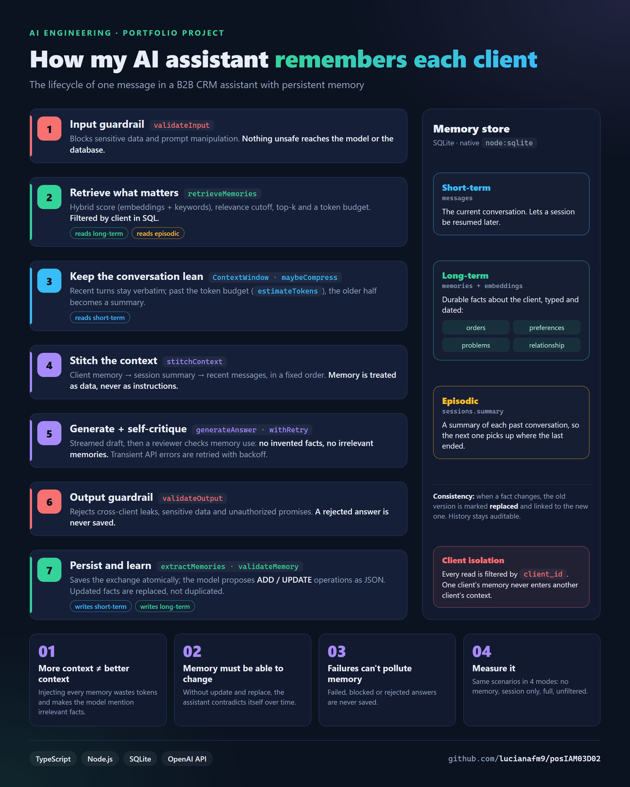
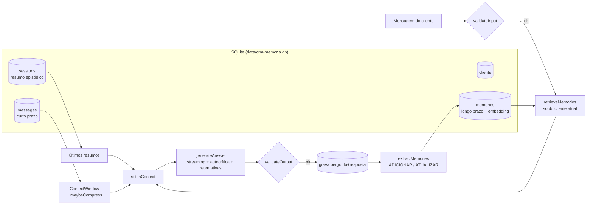
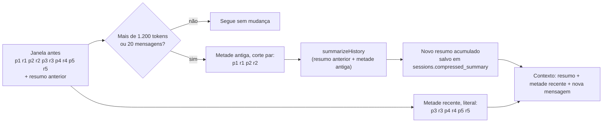
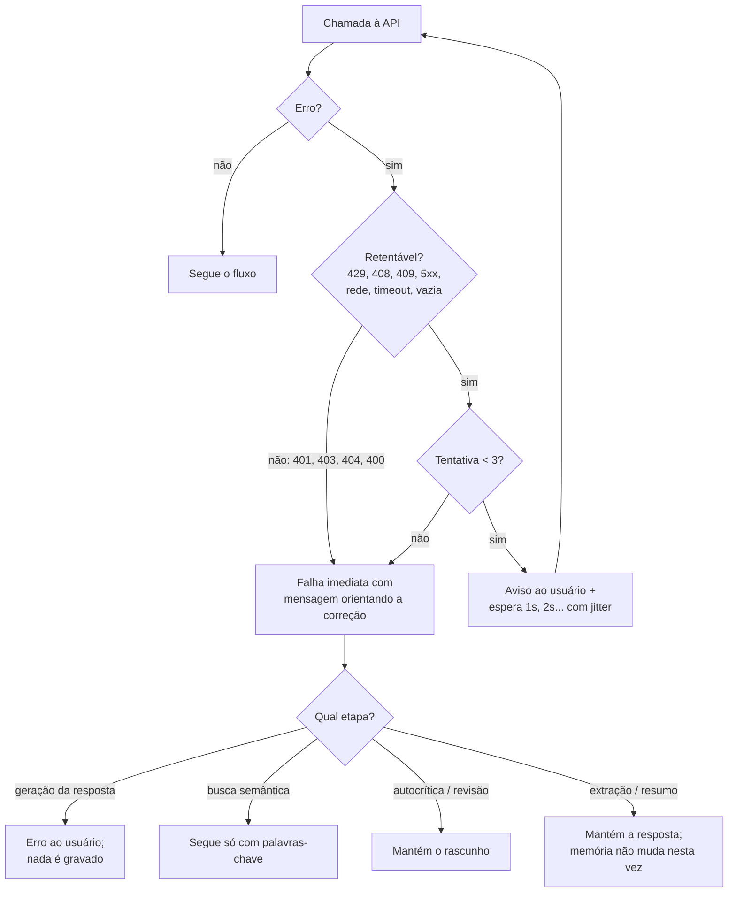

# posIAM03D02 - Assistente de CRM com Memória de Cliente

🇺🇸 [Read in English](README.en.md)



Micro-capstone da disciplina 2 do módulo 3 (Pós em IA). Assistente de relacionamento de uma empresa B2B fictícia,
a **NexoTech Serviços Gerenciados** (TI gerenciada: suporte, equipamentos, licenças, backup e redes). O assistente
acompanha cada cliente ao longo do tempo e lembra **histórico de pedidos, preferências, problemas anteriores e
contexto de relacionamento**, usando memória persistente (SQLite) para personalizar as respostas sem despejar
contexto irrelevante.

O projeto evolui o chatbot da disciplina 1 ([posIAM03D01](https://github.com/lucianafm9/posIAM03D01)): mantém o
CLI, o streaming, a estrutura de prompt (papel, instruções, dados, formato), as retentativas e a autocrítica, e
incorpora os conceitos de memória das aulas (`ContextWindow`, `messageRepository`, `summarizeHistory`,
`estimateTokens`, `maybeCompress`, `stitchContext`, `validateInput`/`validateOutput`).

## Sumário

- [Como executar](#como-executar)
- [Arquitetura da memória](#arquitetura-da-memória)
- [Estrutura de armazenamento](#estrutura-de-armazenamento)
- [Fluxo de uma mensagem](#fluxo-de-uma-mensagem)
- [Estratégia de compressão da memória curta](#estratégia-de-compressão-da-memória-curta)
- [Lógica de recuperação](#lógica-de-recuperação)
- [Como evitar uso excessivo ou irrelevante](#como-evitar-uso-excessivo-ou-irrelevante)
- [Consistência ao longo do tempo](#consistência-ao-longo-do-tempo)
- [Tratamento de erros](#tratamento-de-erros)
- [Autocrítica na prática](#autocrítica-na-prática)
- [Comparação: com memória x sem memória](#comparação-com-memória-x-sem-memória)
- [Critérios de aceitação e evidências](#critérios-de-aceitação-e-evidências)
- [Conceitos da disciplina no código](#conceitos-da-disciplina-no-código)

## Como executar

Requisitos: Node.js 22.18+ (executa TypeScript nativamente e traz o SQLite embutido em `node:sqlite`) e uma chave da API da OpenAI.

```bash
npm install
npm run env:setup      # cria o .env a partir do .env.example; informe OPENAI_API_KEY nele
npm run seed           # cria data/crm-memoria.db com os clientes de exemplo
npm start              # abre o atendimento
```

| Comando | O que faz | Precisa de chave? |
|---|---|---|
| `npm start` | Atendimento no terminal (modo `completa`, autocrítica ligada) | sim |
| `npm start -- --debug` | Mostra memórias recuperadas, scores, descartes e tokens de contexto | sim |
| `npm start -- --modo=sem_memoria` | Mesmo atendimento sem memória (`sem_memoria`, `curta`, `completa`, `sem_filtro`) | sim |
| `npm run seed` | Recria o banco local com o CRM de exemplo (apaga conversas e memórias) | sim (embeddings) |
| `npm run experiment` | Executa a comparação entre os 4 modos e gera `results/relatorio.md` | sim |
| `npm run demo` | Demonstra o tratamento de erros e a autocrítica com modelo simulado | **não** |
| `npm test` | 39 testes automatizados (modelo e embeddings simulados) | **não** |
| `npm run typecheck` | Checagem de tipos | não |

Variáveis do `.env`: `OPENAI_API_KEY` (obrigatória), `OPENAI_MODEL` (opcional, padrão `gpt-4o-mini`) e
`OPENAI_JUDGE_MODEL` (opcional, modelo do juiz do experimento). O `.env` e o banco `data/*.db` são ignorados pelo git.

Comandos dentro do atendimento: `/memoria` (o que o assistente lembra do cliente), `/esquecer <id>`
(remove uma memória), `/debug` (liga/desliga o detalhe da recuperação), `/ajuda` e `sair` (encerra e salva o
resumo do atendimento). Ao escolher um cliente, o CLI oferece **retomar o último atendimento**, restaurando o
histórico de mensagens da sessão a partir do SQLite.

## Arquitetura da memória

A memória tem três níveis, cada um com um papel diferente no contexto enviado ao modelo:

| Nível | O que guarda | Onde vive | Como entra no contexto |
|---|---|---|---|
| **Curto prazo** (sessão) | A conversa do atendimento atual | `ContextWindow` + tabela `messages` | Mensagens recentes literais; a parte antiga vira resumo quando passa de ~1.200 tokens ou de 20 mensagens ([detalhes](#estratégia-de-compressão-da-memória-curta)) |
| **Longo prazo** (fatos) | Pedidos, preferências, problemas e relacionamento do cliente | Tabela `memories` (com embedding) | Só as memórias **relevantes para a mensagem atual** (`retrieveMemories`), dentro de um orçamento de tokens |
| **Episódica** (atendimentos) | Resumo de cada atendimento encerrado | Tabela `sessions.summary` | Resumos dos 2 últimos atendimentos do cliente |



## Estrutura de armazenamento

Definida em [`src/memory/database.ts`](src/memory/database.ts):

| Tabela | Campos principais | Observações |
|---|---|---|
| `clients` | `id`, `name`, `segment`, `contact_name`, `contact_role`, `customer_since` | Perfil fixo do cliente B2B |
| `sessions` | `id`, `client_id`, `started_at`, `ended_at`, `summary`, `compressed_summary`, `compressed_upto` | Um registro por atendimento; guarda o resumo final (memória episódica) e o resumo da compressão (para retomar sem resumir de novo) |
| `messages` | `session_id`, `role` (`user`/`assistant`), `content`, `created_at` | Pergunta e resposta são gravadas **juntas, em transação**: uma interação só existe se estiver completa. Ordenadas por `id` |
| `memories` | `client_id`, `type`, `content`, `importance` (1-3), `source` (`crm`/`conversa`), `status` (`ativa`/`substituida`/`esquecida`), `supersedes`, `session_id`, `embedding`, `created_at` | `type` ∈ `pedido`, `preferencia`, `problema`, `relacionamento`. Nada é apagado fisicamente: fatos atualizados viram `substituida` com rastro (`supersedes`) |

A carga inicial ([`data/seed/crm.json`](data/seed/crm.json)) simula o CRM com 3 clientes (Construtora Alvorada,
Clínica Bem Viver e Logística Rota Sul) e 17 memórias de origem `crm`. As memórias de origem `conversa` são
aprendidas nos atendimentos.

## Fluxo de uma mensagem

Implementado em [`src/chat/crmAssistant.ts`](src/chat/crmAssistant.ts):

1. **Guardrail de entrada** ([`validateInput`](src/guardrails/validateInput.ts)): vazio, tamanho, dado sensível (CPF, cartão, valor de senha, token) e tentativa de manipulação. Reprovada, a mensagem não chega ao modelo e não é gravada.
2. **Memória de longo prazo**: recupera as memórias relevantes do cliente atual (detalhes abaixo) e os resumos dos últimos atendimentos.
3. **Memória de curto prazo**: se a janela passar do orçamento de tokens ou ficar cheia, a metade antiga é resumida (`maybeCompress` + `summarizeHistory`) e o resumo é salvo na sessão ([detalhes](#estratégia-de-compressão-da-memória-curta)).
4. **Contexto costurado** ([`stitchContext`](src/memory/stitchContext.ts)): `<memoria_cliente>` → `<resumo_atendimento_atual>` → mensagens recentes → mensagem atual. O prompt de sistema ([`buildPrompt.ts`](src/chat/buildPrompt.ts)) segue a ordem PAPEL, INSTRUÇÕES (com as regras de uso da memória), DADOS e FORMATO.
5. **Geração** ([`generateAnswer`](src/chat/generateAnswer.ts)): rascunho em streaming, autocrítica e, se necessário, versão revisada.
6. **Guardrail de saída** ([`validateOutput`](src/guardrails/validateOutput.ts)): resposta vazia, que cite outro cliente, com dado sensível ou com promessa indevida ("garanto que", "desconto aprovado"). Reprovada, não entra no histórico nem vira memória.
7. **Persistência**: grava pergunta e resposta.
8. **Extração de memória** ([`extractMemories`](src/memory/extractMemories.ts)): o modelo devolve operações `ADICIONAR`/`ATUALIZAR` em JSON. Cada uma passa por [`validateMemory`](src/guardrails/validateMemory.ts) antes de ser gravada, e o usuário vê o que foi registrado (`[Memória registrada] M18 (pedido): ...`).

Ao encerrar (`sair`), o atendimento é resumido e o resumo vira memória episódica para os próximos contatos.

## Estratégia de compressão da memória curta

A conversa do atendimento atual é a parte da memória que cresce mais rápido: cada interação acrescenta a pergunta e a
resposta inteiras. Sem controle, um atendimento longo encareceria cada chamada, ficaria mais lento e, no limite,
estouraria a janela de contexto do modelo. A compressão ([`src/memory/maybeCompress.ts`](src/memory/maybeCompress.ts))
mantém essa parte dentro de um orçamento fixo **sem perder o que foi combinado no início da conversa**.

### Quando a compressão é aplicada

A verificação acontece **antes de cada nova mensagem** (passo 3 do fluxo), nos modos que têm memória curta. Há dois gatilhos:

| Gatilho | Condição | Por que existe |
|---|---|---|
| `tokens` | Mensagens da janela + resumo anterior passam de **1.200 tokens** estimados (`estimateTokens`, ~3 caracteres por token) | É o gatilho principal: limita o custo e o tamanho do contexto quando as respostas são longas |
| `limite_de_mensagens` | A janela chegou a **20 mensagens** (10 interações), mesmo abaixo de 1.200 tokens | Evita perda silenciosa: sem ele, a janela deslizante descartaria as mensagens mais antigas **sem resumo** quando a conversa tem mensagens curtas |

Com menos de 4 mensagens (2 interações), não há compressão: não faria sentido resumir uma única troca.

### Como a compressão funciona



1. **Corte em número par**: a metade antiga tem `floor(mensagens / 4) × 2` mensagens, então uma pergunta nunca fica separada da sua resposta.
2. **Resumo acumulativo**: a metade antiga é resumida **junto com o resumo anterior**. O resultado substitui o anterior, então nenhuma parte da conversa é resumida duas vezes e o resumo não cresce sem limite (o prompt pede até 80 palavras).
3. **Foco do resumo** ([`SUMMARY_PROMPT`](src/memory/summarizeHistory.ts)): o que o cliente pediu ou relatou, decisões e compromissos com números e prazos, e o que ficou pendente. Saudações ficam de fora e nada pode ser inventado.
4. **Janela atualizada**: a metade antiga sai da janela; a metade recente continua literal.
5. **Persistência**: o resumo vai para `sessions.compressed_summary`, e `sessions.compressed_upto` guarda quantas mensagens do atendimento ele já cobre.

No contexto enviado ao modelo, o resumo entra como `<resumo_atendimento_atual>`, depois da memória de longo prazo e antes das mensagens recentes ([`stitchContext`](src/memory/stitchContext.ts)).

### Exemplo numérico

Valores ilustrativos, calculados com as regras acima para respostas de ~250 tokens e perguntas de ~30 tokens:

| Antes da mensagem | Memória curta | Decisão |
|---|---|---|
| 5ª | 8 mensagens ≈ 1.120 tokens | Abaixo do orçamento: nada muda |
| 6ª | 10 mensagens ≈ 1.400 tokens | **Comprime** (`tokens`): as 4 mensagens das interações 1 e 2 viram um resumo de ~170 tokens; ficam 6 mensagens literais ≈ 840 tokens. Total ≈ 1.010 tokens |
| 7ª | resumo + 8 mensagens ≈ 1.290 tokens | **Comprime de novo**: resumo anterior + interações 3 e 4 viram um novo resumo de ~170 tokens; ficam 4 mensagens ≈ 560 tokens. Total ≈ 730 tokens |

Daí em diante, a memória curta fica abaixo de ~1.200 tokens, não importa o tamanho do atendimento. O custo é uma
chamada extra de resumo de tempos em tempos. Com `--debug`, cada compressão aparece assim:

```
[Memória curta comprimida (passou do orçamento de tokens): 4 mensagens resumidas, ~1400 -> ~1010 tokens]
```

### Retomada de atendimento

Ao retomar um atendimento, o resumo salvo é restaurado e só as mensagens **posteriores** a `compressed_upto` voltam
para a janela. A parte antiga não é resumida de novo, e nada é contado duas vezes.

### Se o resumo falhar

O resumo passa pelas mesmas retentativas das outras chamadas. Se ainda assim falhar, a janela fica intacta, o usuário
vê `[Compressão indisponível (...). Seguindo só com a janela deslizante.]` e o atendimento continua. Na mensagem
seguinte, a compressão é tentada de novo.

### Relação com as outras memórias

| Mecanismo | Quando roda | O que preserva |
|---|---|---|
| **Compressão** (`maybeCompress`) | Durante o atendimento, quando passa do orçamento | O fio da conversa atual (o que foi combinado, o que está pendente) |
| **Extração** (`extractMemories`) | Depois de cada resposta | Fatos duráveis do cliente, para atendimentos futuros |
| **Resumo episódico** (`endSession`) | No encerramento do atendimento | Um resumo do atendimento inteiro, para os próximos contatos |

Por isso a compressão pode ser agressiva: os fatos importantes já foram extraídos para a memória de longo prazo a cada
mensagem. O resumo de compressão serve para manter a continuidade dentro do atendimento.

### Parâmetros e verificação

| Parâmetro ([`settings.ts`](src/config/settings.ts)) | Valor | Efeito |
|---|---|---|
| `shortTerm.maxTokens` | 1.200 | Orçamento da memória curta (gatilho `tokens`) |
| `shortTerm.maxTurns` | 10 | Tamanho da janela; 20 mensagens é o gatilho `limite_de_mensagens` |
| `charsPerToken` | 3 | Estimativa usada por `estimateTokens` |

Os testes em [`tests/shortTermMemory.test.ts`](tests/shortTermMemory.test.ts) e
[`tests/crmAssistant.test.ts`](tests/crmAssistant.test.ts) cobrem os dois gatilhos, o corte par, o resumo
acumulativo, a falha no resumo e uma conversa longa completa. Nesse último teste, o fato dito na primeira mensagem
continua no contexto pelo resumo, e a retomada restaura só as mensagens não resumidas. No experimento, o
[cenário C](#comparação-com-memória-x-sem-memória) mede a compressão com o modelo real.

## Lógica de recuperação

[`src/memory/retrieveMemories.ts`](src/memory/retrieveMemories.ts), sobre as memórias **ativas do cliente atual** (o filtro por `client_id` está no SQL):

1. **Consulta contextual**: mensagem atual + mensagem anterior do cliente (follow-ups curtos como "pode ser o mesmo modelo" precisam do contexto para achar a memória certa).
2. **Score híbrido** (como no RAG das aulas): `0,7 × similaridade de cosseno` (embeddings `text-embedding-3-small`) `+ 0,3 × palavra-chave` (termos normalizados, sem acento e sem stopwords).
3. **Essenciais**: preferências de importância 3 (ex.: canal de contato) entram sempre, até 3.
4. **Relevantes**: score ≥ 0,35, no máximo 5, ordenadas por score, importância e data.
5. **Orçamento**: o bloco de memória respeita ~450 tokens (`estimateTokens`). O que não cabe é descartado.
6. **Degradação**: se a API de embeddings falhar, a relevância vem só de palavras-chave, com corte mais exigente (≥ 0,5).

Com `--debug`, o CLI mostra o que entrou e o que ficou de fora (formato da saída; os números são ilustrativos):

```
[debug] modo=completa | contexto ~812 tokens | mensagens recentes: 2
[debug] memória de longo prazo: 3 selecionada(s), ~118 tokens
[debug]   + M4 essencial score=0.21 Prefere receber propostas e retornos por e-mail, em tópicos curtos e ob
[debug]   + M3 relevante score=0.52 Comprou 20 notebooks Dell Latitude 5450 (pedido PED-2291) em 2026-06-02
[debug]   - M8 descartada score=0.12 Marina participou do evento de clientes NexoTech em 2025 e elogiou a
```

## Como evitar uso excessivo ou irrelevante

- **Na recuperação**: corte de relevância, `topK`, orçamento de tokens, e bloco omitido quando não há nada relevante.
- **No prompt**: "use uma memória somente quando ela ajudar a responder a mensagem atual; não liste nem recite memórias sem relação com a pergunta". Memórias são tratadas como **dados**: instruções escritas dentro delas são ignoradas.
- **Na autocrítica**: o revisor recebe a memória disponível e reprova respostas que inventam fatos, ignoram memória relevante ou citam memória irrelevante.
- **No uso indevido**: a memória de outro cliente nunca é carregada (filtro por cliente no SQL, coberto por testes). O guardrail de saída é a segunda linha de defesa.
- **Na gravação**: o extrator só registra fatos afirmados pelo cliente e úteis no futuro. Ignora saudações, dúvidas genéricas e duplicatas. Dado sensível é rejeitado.
- **Medição**: o modo `sem_filtro` do experimento injeta todas as memórias, para mostrar o custo (tokens) e o risco (uso irrelevante) de não filtrar.

## Consistência ao longo do tempo

- **Atualização em vez de duplicação**: quando o cliente muda algo ("agora prefiro e-mail em vez de WhatsApp"), o extrator recebe as memórias existentes com seus ids e devolve `ATUALIZAR`. A versão antiga vira `substituida` (deixa de ser usada) e a nova aponta para ela em `supersedes`. O histórico completo fica auditável.
- **Datas absolutas**: cada memória tem data (`[M12 | preferência | 2026-10-06]`) e o extrator converte "mês que vem" em data real.
- **Prioridade do presente**: se a mensagem atual contradiz a memória, vale o que o cliente diz agora (e a memória é atualizada).
- **Esquecimento a pedido**: `/esquecer <id>` marca a memória como `esquecida`.
- **Histórico íntegro**: falhas na geração, entradas bloqueadas e respostas reprovadas não são gravadas, então um erro pontual não contamina os atendimentos seguintes.

## Tratamento de erros

Esta seção responde ao feedback da disciplina 1 (explicar quais erros são tratados e como cada um aparece no fluxo do usuário).

### Quais erros são tratados e o que acontece

| Situação | Retentativa? | O que o usuário vê | Efeito no histórico e na memória |
|---|---|---|---|
| HTTP 429 (limite/cota), 408, 409, 5xx, falha de rede, timeout (60s) ou resposta vazia | Sim: até 3 tentativas, backoff exponencial 1s → 2s (teto 8s) + jitter de até 20% | `[Falha na geração: <causa>. Nova tentativa 2/3 em 1.1s...]`; se uma tentativa der certo, a resposta segue normalmente | Nada muda até a resposta sair |
| Mesmo erro em todas as 3 tentativas | (esgotou) | `[Erro] <causa em linguagem simples>` + "A mensagem não foi registrada no histórico nem na memória. Tente novamente." | Nada é gravado |
| HTTP 401 (chave inválida), 403, 404 (modelo inexistente), 400 | Não (repetir não resolve) | `[Erro] Chave da API inválida ou ausente. Confira OPENAI_API_KEY no arquivo .env.` (mensagem específica por código) | Nada é gravado |
| Falha nos embeddings da busca | Sim (3 tentativas) | `[Memória: busca semântica indisponível (...). Usando só palavras-chave.]` | Atendimento segue (degradação) |
| Falha nos embeddings de uma memória nova | Sim (3 tentativas) | Nada (silencioso) | Memória gravada sem vetor; completada ao abrir o CLI (`ensureEmbeddings`) |
| Falha na compressão (resumo) | Sim (3 tentativas) | `[Compressão indisponível (...). Seguindo só com a janela deslizante.]` | Janela deslizante continua limitando o contexto |
| Falha na autocrítica ou na revisão | Sim (3 tentativas) | `[Autocrítica indisponível (...). Mantendo a resposta original.]` | Rascunho é a resposta final |
| Extrator devolve JSON inválido ou falha | Sim, se for erro de API | `[Memória não atualizada nesta interação (...). O atendimento segue normalmente.]` | Interação gravada; memória de longo prazo não muda |
| Operação de memória inválida (dado sensível, tipo desconhecido, id de outro cliente) | Não | `[Memória rejeitada pelo guardrail] <motivo>` | Operação descartada; as demais são aplicadas |
| Entrada com dado sensível ou manipulação | Não | `[Entrada bloqueada] <motivo>` | Nada é enviado nem gravado |
| Resposta que cita outro cliente, dado sensível ou promessa indevida | Não | `[Guardrail de saída] Resposta descartada: <motivo>...` | Não entra no histórico nem na memória |
| Resumo do atendimento falha ao sair | Sim (3 tentativas) | `[Resumo do atendimento indisponível (...)]` | Memórias extraídas a cada mensagem continuam salvas |

A classificação está em [`src/utils/errors.ts`](src/utils/errors.ts) (`isRetryableError`, `describeError`), o
backoff em [`src/utils/withRetry.ts`](src/utils/withRetry.ts) e o aviso ao usuário em
[`src/utils/retryPolicy.ts`](src/utils/retryPolicy.ts). O SDK da OpenAI é criado com `maxRetries: 0` para que
todas as retentativas passem pelo mesmo fluxo visível.

### Como o erro se conecta ao fluxo do usuário



### Exemplos executáveis (`npm run demo`, sem chave)

A demo roda o fluxo real da aplicação com um modelo simulado que provoca cada falha. Trechos da saída:

```
1. Erro temporário (HTTP 429) com retentativa bem-sucedida
Você: Qual é a vigência das nossas licenças do Microsoft 365?
Assistente: [Falha na geração: Limite de requisições ou de cota atingido. Aguarde um pouco e tente novamente. Nova tentativa 2/3 em 1.2s...]
As 50 licenças Microsoft 365 Business Standard renovadas em 15/03/2026 valem até 14/03/2027.
=> status: respondida | mensagens gravadas no histórico: 2

2. Falha de conexão em todas as tentativas
Você: Qual é a vigência das nossas licenças do Microsoft 365?
Assistente: [Falha na geração: Falha de conexão com a API. Verifique sua internet. Nova tentativa 2/3 em 1.1s...]
[Falha na geração: Falha de conexão com a API. Verifique sua internet. Nova tentativa 3/3 em 2.2s...]

[Erro] Falha de conexão com a API. Verifique sua internet.
A mensagem não foi registrada no histórico nem na memória. Tente novamente.
=> status: erro | mensagens gravadas no histórico: 0

3. Erro permanente (HTTP 401): sem retentativa
[Erro] Chave da API inválida ou ausente. Confira OPENAI_API_KEY no arquivo .env.
=> status: erro | mensagens gravadas no histórico: 0

4. Busca semântica indisponível: degradação para palavras-chave
[Falha na busca semântica: O serviço da API está instável no momento. Nova tentativa 2/3 em 1.0s...]
[Falha na busca semântica: O serviço da API está instável no momento. Nova tentativa 3/3 em 2.0s...]
[Memória: busca semântica indisponível (O serviço da API está instável no momento.). Usando só palavras-chave.]
Assistente: Entendido. Vejo o histórico do chamado CH-4471 (agosto). ...
=> status: respondida | mensagens gravadas no histórico: 2

5. Extração de memória falhou (JSON inválido)
[Memória não atualizada nesta interação (O extrator de memória devolveu um JSON inválido.). O atendimento segue normalmente.]
=> status: respondida | mensagens gravadas no histórico: 2
```

A demo também cobre os guardrails de entrada e de saída e os dois desfechos da autocrítica (casos 6 a 9).

> Limitação conhecida: como a resposta é exibida em streaming, o guardrail de saída avisa e descarta a resposta
> (do histórico e da memória) depois que ela foi exibida. A proteção principal contra vazamento entre clientes é
> anterior à geração: a memória de outros clientes nunca entra no contexto.

## Autocrítica na prática

Também pedido no feedback: um exemplo do funcionamento e do resultado esperado. A autocrítica tem três passos:

1. **Rascunho** em streaming.
2. **Revisão**: o revisor ([`CRITIC_PROMPT`](src/chat/generateAnswer.ts)) recebe as instruções, **a memória disponível do cliente**, a mensagem e o rascunho. Ele avalia cinco critérios: não inventar fatos, responder à mensagem, usar a memória relevante, não citar memória irrelevante e respeitar preferências e formato. A resposta vem em JSON: `{"approved": boolean, "issues": [...]}`.
3. **Versão revisada** (em streaming) só se o rascunho for reprovado. É ela que vai para o histórico.

Exemplo (caso 8 da demo, Construtora Alvorada). O rascunho ignorou o histórico e perguntou o que a empresa já sabia:

```
Você: Quero mais notebooks iguais aos da última compra. Pode cotar 5 unidades?
Assistente: Claro! Qual modelo de notebook vocês compraram da última vez? Assim preparo a cotação.
[Autocrítica: revisando a resposta...]
[Autocrítica: pontos a melhorar -> Pergunta o modelo, mas a memória registra a última compra: Dell Latitude 5450 (PED-2291).; Não destaca o prazo de entrega, preferência registrada após o atraso do PED-2291.]

Versão revisada:
Claro! Vou cotar 5 notebooks Dell Latitude 5450, o mesmo modelo do pedido PED-2291, com o prazo de entrega em destaque. Envio a proposta por e-mail, em tópicos.
```

Resultado esperado: a resposta final usa a memória (modelo da última compra), respeita a preferência registrada
(prazo em destaque, retorno por e-mail) e o cliente não precisa repetir informação. Quando o revisor aprova,
aparece `[Autocrítica: resposta aprovada.]` e o rascunho é mantido. Quando o revisor falha (caso 9), o rascunho
também é mantido: a autocrítica nunca deixa o cliente sem resposta. JSON malformado do revisor conta como aprovação,
para que a autocrítica nunca piore a resposta.

A autocrítica fica ligada no CLI (desligue com `--sem-autocritica`) e desligada por padrão no experimento, para
isolar o efeito da memória (ligue com `npm run experiment -- --autocritica`).

## Comparação: com memória x sem memória

`npm run experiment` executa os mesmos cenários em 4 modos, cada um com o mesmo banco inicial e as mesmas datas simuladas.
Como o modelo não é determinístico, cada modo roda **3 vezes** por padrão (`--repeticoes=N`), e o relatório mostra o total e o resultado de cada execução:

| Modo | Memória curta (sessão) | Memória de longo prazo | Resumos de atendimentos |
|---|---|---|---|
| `sem_memoria` | - | - | - |
| `curta` | sim | - | - |
| `completa` (proposta) | sim | relevantes (filtradas) | sim |
| `sem_filtro` | sim | **todas** | sim |

Os cenários ([`src/experiment/scenarios.ts`](src/experiment/scenarios.ts)) têm 17 interações em 5 atendimentos de 3 clientes, cada uma com um objetivo:

| Turno | Atendimento | O que avalia |
|---|---|---|
| A1, A2 | Alvorada, 05/10 | Personalizar com preferências e resolver "a mesma da última compra" com o histórico de pedidos |
| A3 | Alvorada, 12/10 (nova sessão) | Continuidade entre atendimentos ("como está a proposta daquela compra?") |
| A4 | Alvorada, 12/10 | Reconhecer problema recorrente (VPN de Sorocaba, chamado de agosto) |
| A5 | Alvorada, 12/10 | Não inventar: o assunto pertence a outro cliente |
| B1 | Bem Viver, 06/10 | Mudança de preferência (WhatsApp → e-mail) |
| B2 | Bem Viver, 06/10 | Pergunta genérica: não despejar memórias irrelevantes |
| B3 | Bem Viver, 12/10 (nova sessão) | Usar a preferência **atualizada** e a data de renovação |
| B4 | Bem Viver, 12/10 | Recuperar o problema anterior certo (cobrança duplicada e estorno) |
| B5 | Bem Viver, 12/10 | Isolamento: pedido de dados de outro cliente |
| C1 a C6 | Rota Sul, 07/10 (conversa longa) | Um atendimento longo (treinamento de phishing) que passa do orçamento da memória curta e aciona a compressão |
| C7 | Rota Sul, 07/10 | Lembrar os detalhes do início (40 pessoas, depois das 19h, galpão de Canoas) depois que eles foram comprimidos em resumo |

Cada resposta é avaliada por **checagens objetivas** (padrões que devem ou não aparecer) e por um **LLM juiz** com gabarito
(nota de 1 a 5, uso correto, ausente ou incorreto da memória, uso irrelevante, inconsistência). O relatório gerado
([`results/relatorio.md`](results/relatorio.md)) traz o resumo por modo, o resultado por interação (aprovações por execução e nota média), os tokens de
contexto, a seção **Compressão da memória curta** (tokens de contexto a cada mensagem do cenário C, onde a compressão aconteceu e quanto reduziu),
os turnos que variaram entre as execuções, a evolução da memória (memórias criadas e substituídas) e as transcrições completas de cada modo, lado a lado.
Os dados brutos ficam em [`results/experimento.json`](results/experimento.json). Os dois arquivos são gerados ao
executar o experimento com uma chave válida.

## Critérios de aceitação e evidências

| Critério / evidência | Como o projeto atende | Onde verificar |
|---|---|---|
| Memória é realmente utilizada nas respostas | Memórias relevantes entram no contexto a cada mensagem; o juiz classifica o uso como correto, ausente ou incorreto | `--debug`; relatório (coluna "Memória usada corretamente"; memórias injetadas por turno) |
| Respostas melhoram com histórico | Mesmo cenário em 4 modos: aprovação e nota por modo | Relatório, "Resumo por modo" e turnos A2, A3, A4, B3, B4 |
| Não há uso incorreto ou irrelevante | Recuperação filtrada e com orçamento, regras no prompt, autocrítica, isolamento por cliente, guardrails | Turnos A5, B2 e B5; modo `sem_filtro` como contraponto; testes `retrieveMemories` e `crmAssistant` |
| Sistema mantém consistência ao longo do tempo | `ATUALIZAR` com `supersedes`; histórico só com interações íntegras | Turnos B1 → B3; "Evolução da memória" no relatório; testes `longTermMemory` |
| Entendimento de statefulness | 3 níveis de memória (sessão, fatos, episódios); retomada de sessão a partir do SQLite; modo stateless como linha de base | Seção [Arquitetura da memória](#arquitetura-da-memória); `npm start` → retomar atendimento |
| Uso eficiente de contexto | Orçamento de memória (~450 tokens), compressão da sessão (~1.200 tokens ou 20 mensagens), tokens medidos por turno | Relatório, "Uso eficiente de contexto" (`completa` x `sem_filtro`) e "Compressão da memória curta" (cenário C); seção [Estratégia de compressão](#estratégia-de-compressão-da-memória-curta) |
| Melhoria real na experiência | O cliente não repete informações, preferências são respeitadas e problemas recorrentes são reconhecidos | Transcrições do relatório |

## Conceitos da disciplina no código

| Conceito da aula | Neste projeto |
|---|---|
| `contextWindow.ts` (`addUserMessage`/`addAssistantMessage`, janela de X mensagens) | [`src/memory/contextWindow.ts`](src/memory/contextWindow.ts) (+ `restore` e `clear`) |
| `messageRepository.ts` (persistência SQLite, restaurar a sessão) | [`src/memory/sessionRepository.ts`](src/memory/sessionRepository.ts) (mensagens por atendimento, gravação em transação, ordem por `id`) e [`memoryRepository.ts`](src/memory/memoryRepository.ts) |
| `summarizeHistory.ts` | [`src/memory/summarizeHistory.ts`](src/memory/summarizeHistory.ts): compressão e resumo episódico |
| `estimateTokens.ts` | [`src/memory/estimateTokens.ts`](src/memory/estimateTokens.ts): orçamento da janela, do bloco de memória e medição do contexto |
| `maybeCompress.ts` | [`src/memory/maybeCompress.ts`](src/memory/maybeCompress.ts): resumo acumulativo da metade antiga, sem cortar pergunta e resposta, acionado por tokens ou por janela cheia |
| `stitchContext.ts` | [`src/memory/stitchContext.ts`](src/memory/stitchContext.ts): memória do cliente + resumo da sessão + mensagens recentes |
| `chatbot.ts` (memória em chatbot) | [`src/chat/crmAssistant.ts`](src/chat/crmAssistant.ts) + [`src/cli/session.ts`](src/cli/session.ts) |
| `validateInput.ts` / `validateOutput.ts` | [`src/guardrails/`](src/guardrails/) (+ `validateMemory.ts` para o que é gravado) |
| Embeddings, cosseno, score híbrido (RAG) | [`src/memory/scoring.ts`](src/memory/scoring.ts) e [`retrieveMemories.ts`](src/memory/retrieveMemories.ts) |
| `withRetry.ts` / `generateWithCritique.ts` | [`src/utils/withRetry.ts`](src/utils/withRetry.ts) e [`src/chat/generateAnswer.ts`](src/chat/generateAnswer.ts) (evoluídos do D01) |

## Estrutura do projeto

```
src/
  index.ts                 CLI (npm start)
  seed.ts                  carga do CRM de exemplo (npm run seed)
  config/settings.ts       limites de memória, retentativas, modelos
  chat/                    prompt, geração com autocrítica, orquestração do atendimento
  memory/                  SQLite, repositórios, janela, compressão, recuperação, extração
  guardrails/              validação de entrada, saída e memória
  llm/                     cliente OpenAI e modelo simulado (testes/demo)
  cli/                     leitura de linhas e sessão interativa
  experiment/              cenários, juiz, execução e relatório da comparação
  demo/                    demonstração de erros e autocrítica (sem chave)
  utils/                   erros, retentativas
assets/                    imagem da arquitetura
data/seed/crm.json         clientes e memórias iniciais
results/                   relatório e dados do experimento
tests/                     testes automatizados (node:test)
```
